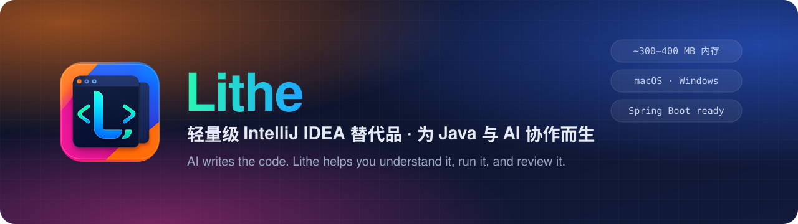
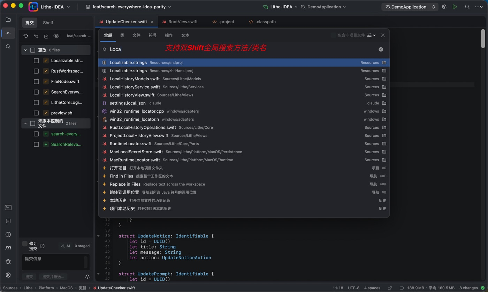
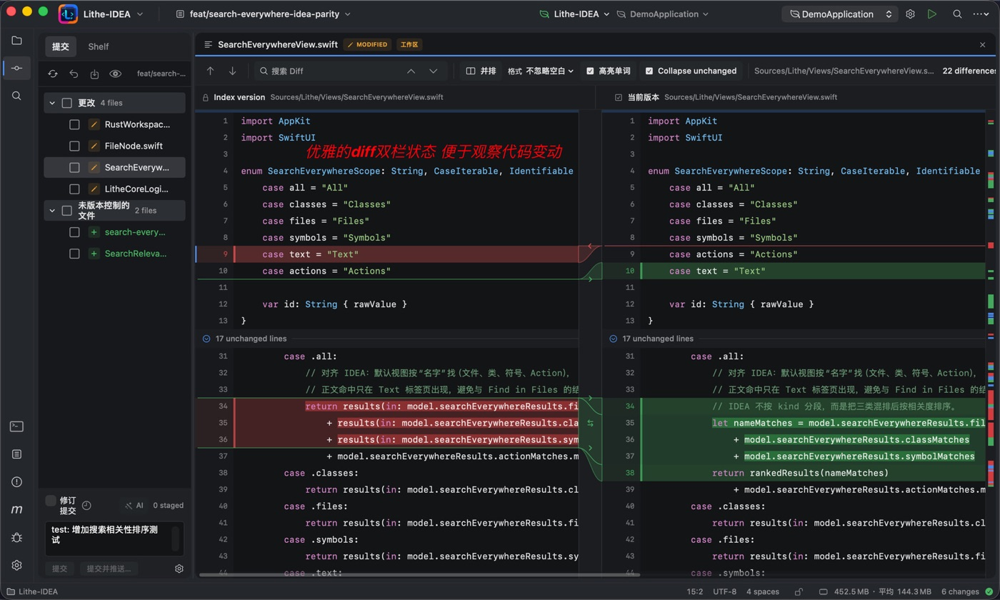
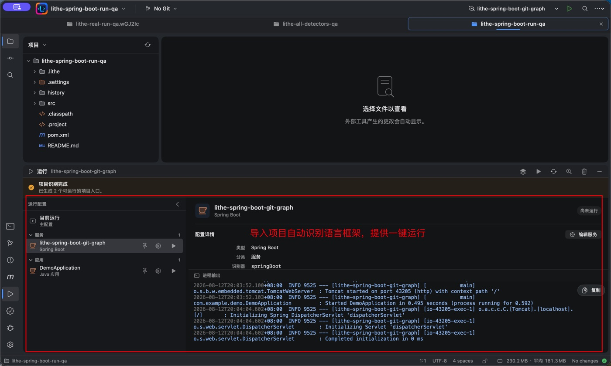
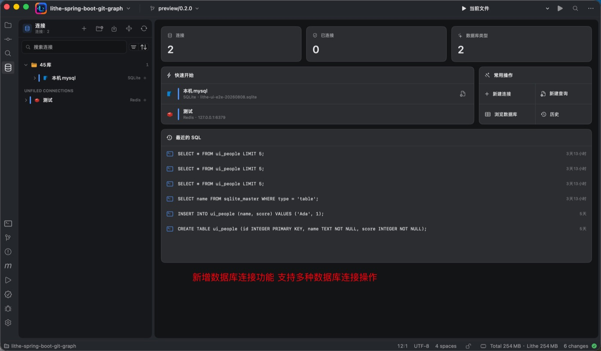
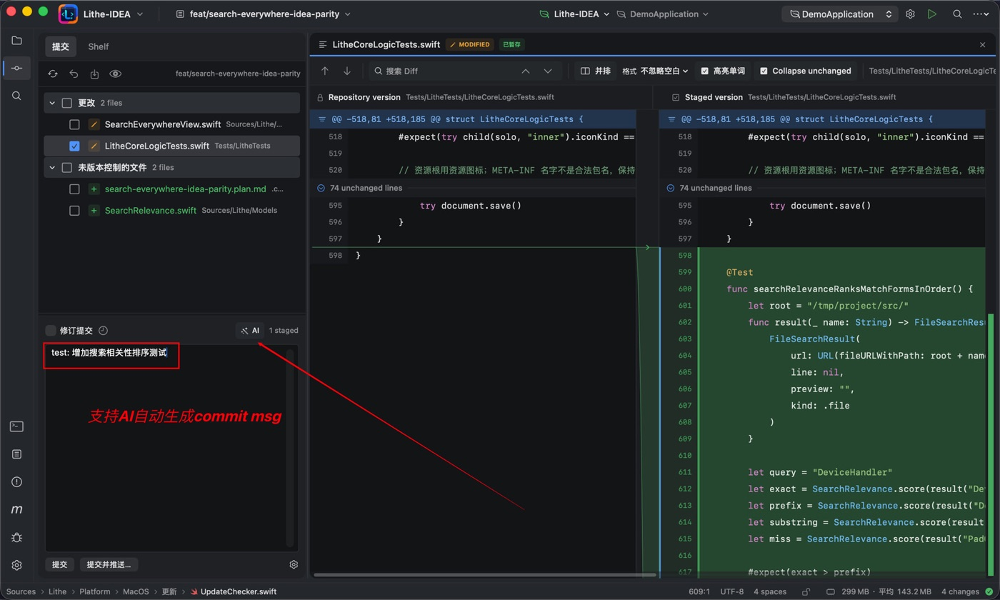
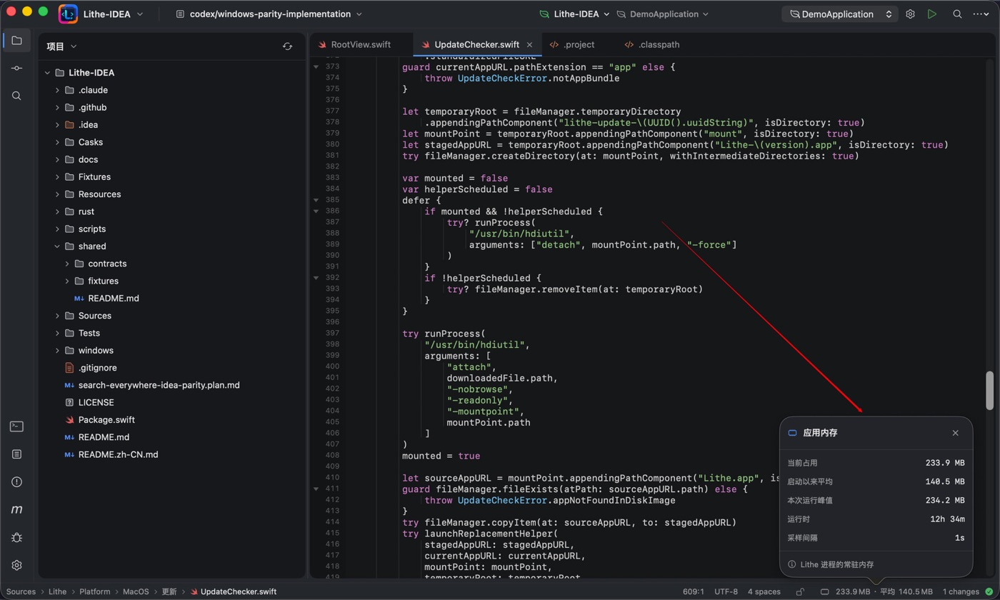

<div align="center">

<a href="https://github.com/Lithe-IDEA/Lithe-IDEA">
  
</a>

<p>
  <a href="https://github.com/Lithe-IDEA/Lithe-IDEA/releases/latest"></a>
  
  
  
</p>

<p>
  <a href="https://github.com/Lithe-IDEA/Lithe-IDEA/releases/latest"><b>⬇️ 下载</b></a> ·
  <a href="https://github.com/Lithe-IDEA/Lithe-store"><b>🧩 插件市场</b></a> ·
  <a href="https://github.com/Lithe-IDEA/Lithe-IDEA/issues"><b>🐛 反馈问题</b></a> ·
  <a href="#-加入社区"><b>💬 加入社区</b></a>
</p>

</div>

> **AI 负责编写代码，Lithe 负责帮你看懂、跑通并审查修改。**
>
> Codex、Claude Code 等 AI 工具已经能承担大量编码工作，但你仍需要一个 IDE 去理解生成的代码、跳转符号、运行调试并审查每一次 Diff。Lithe 保留这些核心工作流，打开普通项目后应用本身的基础内存通常只有 **300～400 MB**，语言服务器、终端、构建工具和调试器全部按需启动。

## ✨ 亮点

<table>
  <tr>
    <td width="33%" valign="top">
      <h3>🪶 轻</h3>
      原生 SwiftUI（macOS）与 Tauri（Windows）外壳，Rust Core 驱动。重组件按需启动，可逐个语言开关语言服务。
    </td>
    <td width="33%" valign="top">
      <h3>☕ 懂 Java</h3>
      面向 Spring Boot 项目：Maven / Gradle、断点调试、自定义运行配置、项目入口自动识别一键运行。
    </td>
    <td width="33%" valign="top">
      <h3>🤖 为 AI 协作设计</h3>
      并排 Git Diff 审查、本地快照历史、AI 生成提交信息，让你快速核对 AI 写下的每一行。
    </td>
  </tr>
  <tr>
    <td width="33%" valign="top">
      <h3>🔍 熟悉的手感</h3>
      双击 Shift 全局搜索、<code>⌘ ⇧ F</code> 全项目搜索替换、多行编辑器标签、多项目同窗打开。
    </td>
    <td width="33%" valign="top">
      <h3>🗄️ 数据库工作区</h3>
      多种数据库连接管理、表浏览、SQL 历史与常用数据库操作，不必再开第二个工具。
    </td>
    <td width="33%" valign="top">
      <h3>🧩 可扩展</h3>
      声明式插件体系与 Lithe Store：Go、PHP、Lua 等语言支持以插件形式按需安装。
    </td>
  </tr>
</table>

## 🖼️ 一览

<p align="center">
  
  
</p>
<p align="center">
  
  
</p>

<details>
<summary>更多截图</summary>
<br>
<p align="center">
  
  
</p>
</details>

## 📦 项目

| 仓库 | 说明 |
| --- | --- |
| 🚀 [**Lithe-IDEA**](https://github.com/Lithe-IDEA/Lithe-IDEA) | Lithe IDE 主仓库（macOS · Windows），Issue 与 PR 请提交到这里 |
| 🛍️ [**Lithe-store**](https://github.com/Lithe-IDEA/Lithe-store) | Lithe 插件市场索引 |
| 🐘 [lithe-plugin-maven](https://github.com/Lithe-IDEA/lithe-plugin-maven) | 声明式 Maven 构建系统插件 |
| 🐘 [lithe-plugin-gradle](https://github.com/Lithe-IDEA/lithe-plugin-gradle) | 声明式 Gradle 构建系统插件 |
| 🐹 [lithe-plugin-go](https://github.com/Lithe-IDEA/lithe-plugin-go) | Go 支持：gopls、运行与 `go test` |
| 🐘 [lithe-plugin-php](https://github.com/Lithe-IDEA/lithe-plugin-php) | PHP 支持：Intelephense、运行与 PHPUnit |
| 🌙 [lithe-plugin-lua](https://github.com/Lithe-IDEA/lithe-plugin-lua) | Lua 支持，也是社区插件的示例与模板 |

## 🚀 安装

**macOS（Homebrew）**

```bash
brew tap lithe-idea/lithe https://github.com/Lithe-IDEA/Lithe-IDEA.git
brew install --cask lithe-idea/lithe/lithe
```

**macOS / Windows 安装包**：前往 [GitHub Releases](https://github.com/Lithe-IDEA/Lithe-IDEA/releases/latest) 下载最新版本。

## 💬 加入社区

欢迎分享使用体验、提出问题、关注最新动态：

- **QQ 群**：[163027877](https://qm.qq.com/cgi-bin/qm/qr?k=&group_code=163027877)
- **微信群**：[通过飞书加入](https://gcnctzuuwe9u.feishu.cn/wiki/HJFbwZ0hZirAPnkWF3xcPWkCnid?from=from_copylink)
- **问题与建议**：[GitHub Issues](https://github.com/Lithe-IDEA/Lithe-IDEA/issues)

<div align="center">
<sub>如果 Lithe 对你有帮助，欢迎点一个 ⭐ Star 支持我们。</sub>
</div>
