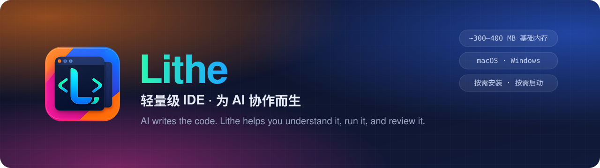

<div align="center">

<a href="https://github.com/1lck/Lithe-IDEA">
  
</a>

<p>
  <a href="https://github.com/1lck/Lithe-IDEA/releases/latest"></a>
  
  
  <a href="https://github.com/1lck/Lithe-IDEA/blob/main/LICENSE"></a>
</p>

<p>
  <a href="https://lithe.top"><b>🌐 官网</b></a> ·
  <a href="https://github.com/1lck/Lithe-IDEA/releases/latest"><b>⬇️ 下载</b></a> ·
  <a href="https://github.com/Lithe-IDEA/Lithe-store"><b>🧩 插件市场</b></a> ·
  <a href="https://github.com/Lithe-IDEA/lithe-plugin-docs"><b>📚 开发插件</b></a> ·
  <a href="https://github.com/1lck/Lithe-IDEA/issues"><b>🐛 反馈问题</b></a> ·
  <a href="#-加入社区"><b>💬 加入社区</b></a>
</p>

</div>

> **AI 负责编写代码，Lithe 负责帮你看懂、跑通并审查修改。**
>
> Lithe 是面向 Java 开发与 AI 协作的轻量级 IntelliJ IDEA 替代品，保留代码浏览、编辑与导航、搜索、运行调试和修改审查等核心工作流。

打开普通项目后，Lithe 应用本身的基础内存占用通常约为 **300～400 MB**。语言服务器、终端、构建工具和调试器均按需启动；实际占用会随项目和启用的服务变化。

## ✨ 亮点

<table>
  <tr>
    <td width="33%" valign="top">
      <h3>🪶 轻</h3>
      原生 SwiftUI（macOS）与 Tauri（Windows）外壳，Rust Core 驱动。重组件按需启动，可逐个语言开关语言服务。
    </td>
    <td width="33%" valign="top">
      <h3>🧩 万物皆插件</h3>
      从语言服务、构建系统、调试器到数据库与工具窗口，能力逐步由插件提供。按需安装、启用和卸载，保持工作台轻量。
    </td>
    <td width="33%" valign="top">
      <h3>🤖 为 AI 协作设计</h3>
      在编辑区与 Agent 对话，查看上下文用量与文件更改；结合并排 Git Diff、本地历史和 AI 提交信息，理解并审查每次修改。
    </td>
  </tr>
  <tr>
    <td width="33%" valign="top">
      <h3>🔍 熟悉的手感</h3>
      双击 Shift 全局搜索、<code>⌘ ⇧ F</code> 全项目搜索替换、多行标签、多项目同窗打开，以及 Markdown / HTML 并排预览。
    </td>
    <td width="33%" valign="top">
      <h3>🌿 Git 与工作树</h3>
      并排 Diff、提交图、分支与工作树管理，结合本地快照历史，方便在多个任务间切换并追踪修改。
    </td>
    <td width="33%" valign="top">
      <h3>🛠️ 开发工具</h3>
      通过插件使用数据库、HTTP 请求和 Docker 等工具，在同一工作台查看数据、调试接口与管理容器。
    </td>
  </tr>
</table>

macOS 是当前参考产品，Windows 为独立实现；两端功能进度见[跨平台功能矩阵](https://1lck.github.io/Lithe-IDEA/platform-feature-matrix/)。

## 🧩 插件生态

- **安装插件**：在 macOS 的「设置 → 插件 → 插件市场」浏览 [Lithe Store](https://github.com/Lithe-IDEA/Lithe-store)。各插件的安装方式与所需 Lithe 版本见各自仓库。
- **开发插件**：从 [lithe-plugin-docs](https://github.com/Lithe-IDEA/lithe-plugin-docs) 开始，查看开发指南、契约、教程和官方 **Node.js / Java / Rust SDK**。
- **发布插件**：插件在作者自己的仓库开发和发布，按 [Lithe Store 发布指南](https://github.com/Lithe-IDEA/Lithe-store/blob/main/docs/publishing.md)申请收录。

## 🖼️ 一览

以下为主仓库最新的 macOS 产品截图，点击可查看原图。截图直接引用主仓库资源。

**Git、Diff 与工作树**：在同一窗口切换项目、审查修改、编写提交信息，并查看和管理 Git 工作树。

<p align="center">
  <a href="https://github.com/1lck/Lithe-IDEA/blob/main/docs/assets/screenshots/git-diff-worktrees.png"></a>
</p>

**AI 对话与上下文**：在编辑区与 Agent 对话，查看命令执行记录、上下文用量、文件更改和会话统计。

<p align="center">
  <a href="https://github.com/1lck/Lithe-IDEA/blob/main/docs/assets/screenshots/agent-chat-context.png"></a>
</p>

<details>
<summary>更多截图</summary>

**全局搜索与 Markdown 预览**

<p align="center">
  <a href="https://github.com/1lck/Lithe-IDEA/blob/main/docs/assets/screenshots/search-everywhere-markdown.png"></a>
</p>

**Git 历史与分支浏览**

<p align="center">
  <a href="https://github.com/1lck/Lithe-IDEA/blob/main/docs/assets/screenshots/git-history-markdown.png"></a>
</p>

**HTML 预览与运行服务**

<p align="center">
  <a href="https://github.com/1lck/Lithe-IDEA/blob/main/docs/assets/screenshots/html-preview-run-services.png"></a>
</p>

**插件管理与原生调试**：语言、构建和调试插件，以及 LLDB 反汇编与寄存器视图。

<p align="center">
  <a href="https://github.com/1lck/Lithe-IDEA/blob/main/docs/assets/screenshots/plugins-native-debugging.png"></a>
</p>

**Agent 资源与 MCP 配置**：管理指令、技能、Hooks 和 MCP 配置。

<p align="center">
  <a href="https://github.com/1lck/Lithe-IDEA/blob/main/docs/assets/screenshots/agent-mcp-settings.png"></a>
</p>

</details>

## 📦 项目

| 仓库 | 说明 |
| --- | --- |
| 🚀 [**1lck/Lithe-IDEA**](https://github.com/1lck/Lithe-IDEA) | Lithe IDE 主仓库（macOS · Windows），Issue 与 PR 请提交到这里 |
| 🛍️ [**Lithe-store**](https://github.com/Lithe-IDEA/Lithe-store) | Lithe 插件市场索引 |
| 📚 [**lithe-plugin-docs**](https://github.com/Lithe-IDEA/lithe-plugin-docs) | 插件开发入口：指南、教程、契约与 Node.js / Java / Rust SDK |

以下社区插件目前面向 **macOS**；部分仍为预发布，所需 Lithe 版本与安装方式以各自仓库为准。

| 领域 | 仓库 | 说明 |
| --- | --- | --- |
| 数据库 | [lithe-plugin-database](https://github.com/Lithe-IDEA/lithe-plugin-database) | MySQL、MariaDB、PostgreSQL、SQLite、SQL Server、MongoDB、Redis、Nacos |
| 工具 | [lithe-plugin-http-client](https://github.com/Lithe-IDEA/lithe-plugin-http-client) | HTTP 请求、响应查看与 JSON 格式化（预览版） |
| 工具 | [lithe-plugin-docker](https://github.com/Lithe-IDEA/lithe-plugin-docker) | Docker 容器、镜像、日志、统计与文件传输；下载发行包从磁盘安装 |
| 调试 | [lithe-plugin-lldb](https://github.com/Lithe-IDEA/lithe-plugin-lldb) | 通过 lldb-dap 调试 C / C++ / Objective-C / Swift / Rust（预发布） |
| 构建 | [lithe-plugin-maven](https://github.com/Lithe-IDEA/lithe-plugin-maven) | Maven 工程、构建、测试与依赖树（预发布） |
| 构建 | [lithe-plugin-gradle](https://github.com/Lithe-IDEA/lithe-plugin-gradle) | Gradle 工程、任务、运行与测试（预发布） |
| 构建 | [lithe-plugin-cargo](https://github.com/Lithe-IDEA/lithe-plugin-cargo) | Cargo workspace 构建、检查、测试与运行（预发布） |
| 版本控制 | [lithe-plugin-svn](https://github.com/Lithe-IDEA/lithe-plugin-svn) | Subversion 变更、提交、历史与基线比较（预发布） |
| 语言 | [lithe-plugin-go](https://github.com/Lithe-IDEA/lithe-plugin-go) | Go 支持：gopls、运行与 `go test` |
| 语言 | [lithe-plugin-php](https://github.com/Lithe-IDEA/lithe-plugin-php) | PHP 支持：Intelephense、运行与 PHPUnit |
| 语言 | [lithe-plugin-lua](https://github.com/Lithe-IDEA/lithe-plugin-lua) | Lua 支持，也是社区插件的示例与模板 |

## 🚀 安装

**macOS（Homebrew）**

```bash
brew tap lithe-idea/lithe https://github.com/1lck/Lithe-IDEA.git
brew install --cask lithe-idea/lithe/lithe
brew upgrade --cask lithe
```

**macOS / Windows 安装包**：前往 [GitHub Releases](https://github.com/1lck/Lithe-IDEA/releases/latest) 下载。macOS 13+ 的 M 系列芯片选择 `arm64.dmg`，Intel 芯片选择 `x86_64.dmg`；Windows x64 选择 `.exe` 安装包。

macOS 安装遇到系统验证提示时，参见[主仓库安装说明](https://github.com/1lck/Lithe-IDEA/blob/main/README.zh-CN.md#macos-提示无法打开-litheapp)。

## 💬 加入社区

欢迎分享使用体验、提出问题、关注最新动态：

- **QQ 群**：[163027877](https://qm.qq.com/cgi-bin/qm/qr?k=&group_code=163027877)
- **微信群**：[查看主仓库的最新入群方式](https://github.com/1lck/Lithe-IDEA/blob/main/README.zh-CN.md#欢迎加入群聊)
- **问题与建议**：[GitHub Issues](https://github.com/1lck/Lithe-IDEA/issues)

<div align="center">
<sub>如果 Lithe 对你有帮助，欢迎点一个 ⭐ Star 支持我们。</sub>
</div>
